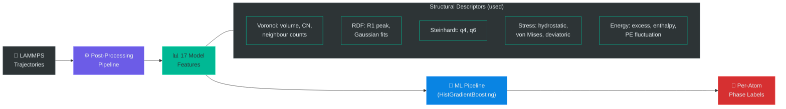

# Amorphous Phase ML

[](https://github.com/miladgk/amorphous-phase-ml/actions/workflows/ci.yml)
[](https://opensource.org/licenses/MIT)
[](https://www.python.org/downloads/release/python-3100/)

An end-to-end framework for **polyamorphous phase identification in Cu–Zr metallic glasses**. It takes LAMMPS molecular dynamics dumps, computes structural descriptors per atom, and trains a gradient-boosted classifier on three reference glasses (Cu₅₀Zr₅₀, Cu₄₆Zr₅₄, Cu₆₄Zr₃₆) to label the atoms of a polyamorphous target box.

Live results and figures: the dashboard is published from `docs/` (GitHub Pages).

---

## Architecture



---

## Key Results

Spatial holdout: atoms with |x − median| < 3.5 Å removed from the target box; 16,227 test atoms.

| Metric | Value |
|--------|-------|
| Classifier | HistGradientBoostingClassifier, 17 features |
| CV macro F1 (5-fold, stratified, training split) | **0.670** |
| Holdout accuracy | **67.8 %** (11,003 / 16,227) |
| F1 Cu₅₀Zr₅₀ / Cu₄₆Zr₅₄ / Cu₆₄Zr₃₆ | **0.504 / 0.590 / 0.900** |
| Target box | 36,828 atoms, features averaged over 9 snapshots (dt = 2 fs, about 2 ns apart) |
| Reference boxes | 11 snapshots each, one simulation box per phase |

Limitation: each reference phase is a single simulation box, so the holdout does not test transfer to independent simulations (see PIPELINE.md §9.9).

---

## What the Results Show 🔬

### 1. Cu₆₄Zr₃₆ is separated well (F1 = 0.900, recall 91 %)
- On the spatial holdout, 5,416 of 5,958 true Cu₆₄Zr₃₆ atoms are classified correctly. The errors go to Cu₅₀Zr₅₀ (500 atoms) and Cu₄₆Zr₅₄ (42 atoms).
- In the predicted map of the target box, the Cu₆₄Zr₃₆ region begins near x ≈ 120–125 Å and occupies the rest of the box (`docs/assets/phase_spatial_distribution.png`).

### 2. Cu₅₀Zr₅₀ and Cu₄₆Zr₅₄ are not separated well (F1 = 0.504 and 0.590)
- On the holdout, 40.6 % of true Cu₅₀Zr₅₀ atoms are predicted as Cu₄₆Zr₅₄, and 37.6 % of true Cu₄₆Zr₅₄ atoms are predicted as Cu₅₀Zr₅₀.
- The two compositions differ by 4 at.% Cu. With these descriptors they overlap strongly, so their F1 values stay low.
- An exploratory species-blind SOAP descriptor raised these two F1 values, but the result is not adopted because a box-identity confound has not been excluded (`Machine_Learning_Pipeline_for_Materials_Science/experiments/soap_species_blind/RESULT.md`).

### 3. Measures in the pipeline
- **Spatial consensus smoothing:** periodic neighbour averaging of class probabilities (`apply_spatial_consensus` in `train_and_predict.py`; cutoff 3.6 Å, weight 0.35; periodic box read from the LAMMPS dump).
- **Confidence cutoffs:** the dashboard reports the fraction of atoms at confidence ≥ 0.50, 0.60, 0.70, 0.80 and 0.90. At 0.50, 15.6 % of atoms remain uncertain.

---

## Repository Structure 📂

```
amorphous-phase-ml/
│
├── README.md                                          # This file
├── PIPELINE.md                                        # Technical specification (features, algorithms, parameters)
├── DATA.md                                            # Data files and how to regenerate them
├── LICENSE                                            # MIT License
├── environment.yml                                    # Conda environment
├── requirements.txt                                   # pip dependencies
├── .github/workflows/ci.yml                           # CI: runs the ML unit tests
│
├── docs/                                              # GitHub Pages site (dashboard + figures)
│   ├── index.html                                     # Interactive dashboard
│   └── assets/                                        # Validation JSON, dashboard data, figures
│
├── Atomic_Simulation_Post-Processing_Pipeline/        # Feature extraction from LAMMPS dumps
│   ├── README.md
│   ├── config.yaml                                    # Pipeline configuration
│   ├── config/freud.ini
│   ├── src/                                           # pipeline_orchestrator.py, snapshot_processor.py, rdf.py, ...
│   ├── files/snapshots_{5050,4654,6436}/              # Reference LAMMPS dumps (11 snapshots each)
│   └── outputs/                                       # Feature tables (see DATA.md)
│
├── Machine_Learning_Pipeline_for_Materials_Science/   # Training and prediction
│   ├── README.md
│   ├── src/general_phase_id/                          # train_and_predict.py, build_descriptors.py, ref_config.yaml
│   ├── src/process_trajectory.py                      # Older trajectory helper (legacy, see its README note)
│   ├── data/polyamorphous/                            # Target LAMMPS dumps (9 snapshots)
│   ├── tests/                                         # Unit tests (pytest)
│   ├── experiments/soap_species_blind/                # Exploratory SOAP result (not adopted)
│   └── scripts/generate_rigor_artifacts.py
│
└── general_phase_id_output/                           # Trained model and predictions
    ├── model.pkl                                      # Classifier (17 features)
    ├── config_used.yaml                               # Configuration of the run
    ├── norm_params.pkl, feature_ranges.pkl
    ├── permutation_importance.json
    ├── predictions.csv                                # Per-atom predictions (not tracked; large)
    ├── predicted_phases.xyz / .lammpstrj              # Visualisation outputs
    └── plots/                                         # Figures
```

---

## Installation ⚙️

Tested with Python 3.10.

```bash
# Conda (recommended)
conda env create -f environment.yml
conda activate materials-sim-ml

# or pip
python -m venv .venv
source .venv/bin/activate
pip install -r requirements.txt
```

The post-processing step needs `freud-analysis` 3.2 and `pyvoro` 1.3.2 (see `environment.yml`).

---

## Quick Start

Run all commands from the repository root.

```bash
# 1. Feature extraction (per dataset; see Atomic_Simulation_Post-Processing_Pipeline/README.md and DATA.md)
python Atomic_Simulation_Post-Processing_Pipeline/src/pipeline_orchestrator.py \
    --config Atomic_Simulation_Post-Processing_Pipeline/config.yaml

# 2. Train on the reference boxes and predict the target box (17 features)
python Machine_Learning_Pipeline_for_Materials_Science/src/general_phase_id/train_and_predict.py \
    --config Machine_Learning_Pipeline_for_Materials_Science/src/general_phase_id/ref_config.yaml

# 3. Figures and dashboard data
python scripts/generate_dark_figures.py

# 4. Tests
pytest Machine_Learning_Pipeline_for_Materials_Science/tests/ -v
```

The feature tables used by step 2 are not in git because of their size. See [DATA.md](DATA.md) for how to regenerate them.

---

## Documentation

| Document | Description |
|----------|-------------|
| [PIPELINE.md](PIPELINE.md) | Technical specification: every feature, algorithm and parameter, with the current state at the top |
| [DATA.md](DATA.md) | Data files, sizes, tracking status and regeneration steps |
| [Atomic_Simulation_Post-Processing_Pipeline/README.md](Atomic_Simulation_Post-Processing_Pipeline/README.md) | Feature extraction |
| [Machine_Learning_Pipeline_for_Materials_Science/README.md](Machine_Learning_Pipeline_for_Materials_Science/README.md) | Training and prediction |

---

## License

This project is licensed under the [MIT License](LICENSE).
