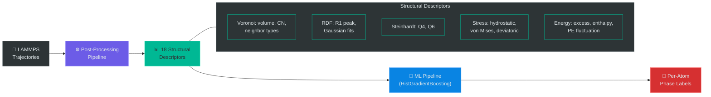

# Amorphous Phase ML

[](https://github.com/MiladGK/ml_rdf/actions/workflows/ci.yml)
[](https://opensource.org/licenses/MIT)
[](https://www.python.org/downloads/release/python-3100/)

An end-to-end framework for **polyamorphous phase identification in metallic glasses**, combining atomistic simulation post-processing with machine learning. The pipeline takes raw LAMMPS molecular dynamics trajectories, extracts 18 structural descriptors per atom, and trains gradient-boosted classifiers to identify distinct amorphous phases at the atomic scale.

---

## Architecture



---

## Key Results

| Metric | Value |
|--------|-------|
| Classifier | HistGradientBoostingClassifier |
| CV Score (macro F1) | **0.854** |
| Regressor R² (Cu fraction) | **0.972** |
| Target System | Cu-Zr metallic glasses |
| Classes | Cu₅₀Zr₅₀ · Cu₄₆Zr₅₄ · Cu₆₄Zr₃₆ |

---

## Repository Structure 📂

```
project/
│
├── README.md                                          # This file — general overview
├── PIPELINE.md                                        # Full technical specification
├── DATA.md                                            # Data regeneration guide
├── CODE_OF_CONDUCT.md                                 # Community standards
├── LICENSE                                            # MIT License
├── environment.yml                                    # Conda environment specification
├── requirements.txt                                   # pip dependencies (alternative)
│
├── Atomic_Simulation_Post-Processing_Pipeline/         # Post-processing pipeline
│   ├── README.md                                      # Detailed docs for post-processing pipeline
│   ├── config.yaml                                    # Pipeline configuration
│   ├── config/freud.ini                               # freud library configuration
│   ├── input.txt                                      # Input parameters
│   ├── requirements.txt                               # Python dependencies
│   ├── src/                                           # Source code
│   │   ├── pipeline_orchestrator.py                   # Main pipeline entry point
│   │   ├── pipeline_mpi.py                            # MPI-parallelized pipeline
│   │   ├── snapshot_processor.py                      # Per-snapshot processing
│   │   ├── io_module.py                               # LAMMPS dump I/O
│   │   ├── rdf.py                                     # RDF computation
│   │   ├── voronoi.py                                 # Voronoi tessellation
│   │   ├── peak_analysis.py                           # RDF peak detection
│   │   ├── temporal_averaging.py                      # Temporal averaging
│   │   ├── spatial_analysis_levels.py                 # Spatial analysis
│   │   ├── *.py                                       # Feature injection & workflow scripts
│   │   └── *.sh                                       # Shell workflow runners
│   ├── files/snapshots_{5050,4654,6436}/             # LAMMPS snapshot data
│   └── outputs/                                       # Generated outputs (CSVs, plots)
│
├── Machine_Learning_Pipeline_for_Materials_Science/   # ML pipeline
│   ├── README.md                                      # Detailed docs for ML pipeline
│   ├── config.yaml                                    # ML pipeline configuration
│   ├── src/                                           # Source code
│   │   ├── pipeline.py                                # Main training pipeline
│   │   ├── models.py                                  # Model construction & tuning
│   │   ├── data_utils.py                              # Data loading & splitting
│   │   ├── feature_builder_data_clean.py              # Feature engineering
│   │   ├── explainability.py                          # Model interpretability
│   │   ├── analyze_feature_importance.py              # Feature importance analysis
│   │   ├── apply_model_to_unlabeled.py                # Model deployment
│   │   └── *.py                                       # Experiment & validation scripts
│   ├── data/polyamorphous/                            # Polyamorphous dataset
│   ├── tests/                                         # Unit tests
│   └── outputs/                                       # Models, plots, SHAP data
│
└── general_phase_id_output/                           # Trained model artifacts
    ├── model.pkl                                      # HistGB classifier
    ├── norm_params.pkl                                # Frozen normalization parameters
    ├── feature_ranges.pkl                             # OOD detection ranges
    └── predicted_phases.lammpstrj                     # LAMMPS output with predictions
```

---

## Installation ⚙️

### Option 1: Conda (Recommended)

```bash
# Install system packages (Linux/WSL)
sudo apt update && sudo apt install build-essential

# Create and activate the environment
conda env create -f environment.yml
conda activate materials-sim-ml
```

### Option 2: pip

```bash
python -m venv .venv
source .venv/bin/activate
pip install -r requirements.txt
```

---

## Sub-Projects 🚀

### 📦 Atomic Simulation Post-Processing Pipeline

- Parallelized analysis of LAMMPS trajectories with MPI support.
- Computes RDFs, Voronoi descriptors, bond order parameters (Q4, Q6), bond angle distributions, CSRO, and multi-level MRO features.
- Performs peak analysis, temporal/spatial averaging, and spatial kernel smoothing.
- Includes feature injection scripts and workflow automation (shell + Python runners).

*See `Atomic_Simulation_Post-Processing_Pipeline/README.md` for full documentation.*

### 🤖 Machine Learning Pipeline for Materials Science

- Configurable ML pipeline for 2-class and 3-class classification on per-atom data.
- Supports Random Forest, HistGB, LinearSVC with hyperparameter tuning.
- Group-aware splitting, explainability (SHAP, permutation importance), and model calibration.
- Experiment scripts for calibrated, domain-robust, hybrid, and MRO-boosted approaches.
- Production-ready deployment for applying trained models to new datasets.

*See `Machine_Learning_Pipeline_for_Materials_Science/README.md` for full documentation.*

---

## Quick Start

```bash
# Activate environment
conda activate materials-sim-ml

# Run the post-processing pipeline on a dataset
python Atomic_Simulation_Post-Processing_Pipeline/src/pipeline_orchestrator.py \
    --config Atomic_Simulation_Post-Processing_Pipeline/config.yaml

# Train ML models on processed features
python Machine_Learning_Pipeline_for_Materials_Science/src/pipeline.py \
    --config Machine_Learning_Pipeline_for_Materials_Science/config.yaml
```

---

## Documentation

| Document | Description |
|----------|-------------|
| [PIPELINE.md](PIPELINE.md) | Full technical specification — every feature, every algorithm, every parameter |
| [DATA.md](DATA.md) | Data regeneration guide — how to reproduce CSV files from raw LAMMPS dumps |

---

## License

This project is licensed under the [MIT License](LICENSE).